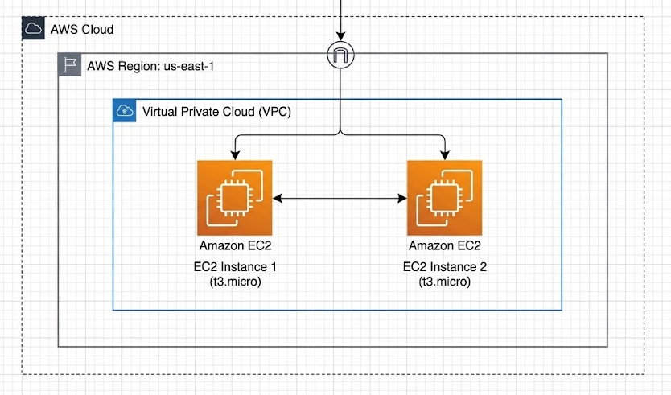

# Ejercicio 1: Primeres instàncies EC2 amb Terraform

## Descripción general

Este ejercicio introduce el uso básico de Terraform como infraestructura como código (IaC) sobre AWS. El objetivo es declarar y desplegar **dos instancias EC2** de tipo `t3.micro` con **Amazon Linux 2023** en la región **`us-east-1`**.

La configuración:

- Define el proveedor de AWS y fija la región `us-east-1`.
- Obtiene dinámicamente la AMI oficial más reciente de Amazon Linux 2023 mediante un `data source` de Terraform.
- Crea dos instancias EC2 utilizando el meta-argumento `count`.
- Asigna etiquetas (`tags`) comunes y un nombre dinámico a cada instancia: `Instancia-1` e `Instancia-2`.
- Expone como salida los IDs y las IP públicas de las instancias creadas.

## Estructura del proyecto

```text
pt1-4-ex1/
├── assets/
│   └── topologia.png
├── README.md
└── main.tf
```

## Topología de red



> **Nota:** la arquitectura de la topología fue diseñada en **draw.io** y posteriormente exportada como imagen PNG en `assets/topologia.png`.

El despliegue se realiza en la VPC por defecto de la región `us-east-1`. Terraform crea las dos instancias EC2 y AWS les asigna automáticamente una subred disponible, un grupo de seguridad por defecto y, cuando corresponde, una dirección IP pública. No se define una VPC, subred ni Security Group propios en este primer ejercicio.

## Recursos declarados

| Recurso | Nombre | Descripción |
| --- | --- | --- |
| `terraform` | — | Versión mínima de Terraform y proveedor de AWS. |
| `provider` | `aws` | Proveedor de AWS configurado en `us-east-1`. |
| `data.aws_ami` | `amazon_linux_2023` | AMI oficial más reciente de Amazon Linux 2023 (`x86_64`). |
| `aws_instance` | `web` | Dos instancias EC2 `t3.micro` creadas con `count = 2`. |

## Requisitos previos

- [Terraform](https://developer.hashicorp.com/terraform/install) instalado (versión `1.5.0` o superior).
- Una cuenta de AWS con permisos para crear instancias EC2, consultar AMIs y leer la VPC por defecto.
- Credenciales de AWS configuradas en el entorno. Por ejemplo, mediante el AWS CLI:

  ```bash
  aws configure
  ```

  También se pueden exportar como variables de entorno:

  ```bash
  export AWS_ACCESS_KEY_ID="<ACCESS_KEY_ID>"
  export AWS_SECRET_ACCESS_KEY="<SECRET_ACCESS_KEY>"
  export AWS_SESSION_TOKEN="<SESSION_TOKEN>"   # Solo si se usan credenciales temporales.
  export AWS_DEFAULT_REGION="us-east-1"
  ```

- La imagen `assets/topologia.png` debe existir para que se visualice correctamente en este README.

## Procedimiento paso a paso

1. **Situarse en el directorio del ejercicio.**

   ```bash
   cd pt1-4-ex1
   ```

2. **Revisar la configuración de `main.tf`.**

   - El bloque `terraform` fija la versión mínima de Terraform y la versión del proveedor `hashicorp/aws`.
   - El bloque `provider "aws"` establece la región `us-east-1`.
   - El `data "aws_ami" "amazon_linux_2023"` busca la AMI más reciente de Amazon Linux 2023 con arquitectura `x86_64`, virtualización `hvm` y disco raíz EBS.
   - El recurso `aws_instance.web` usa `count = 2` para crear dos instancias idénticas.
   - La etiqueta `Name` se construye con `Instancia-${count.index + 1}`, generando `Instancia-1` e `Instancia-2`.
   - Los bloques `output` muestran los IDs y las IP públicas al finalizar el despliegue.

3. **Inicializar el proyecto de Terraform.**

   ```bash
   terraform init
   ```

   Este paso descarga el proveedor de AWS, crea el directorio `.terraform/` y genera el archivo de bloqueo `.terraform.lock.hcl`.

4. **Validar y revisar el plan de ejecución.**

   ```bash
   terraform validate
   terraform plan
   ```

   `terraform validate` comprueba la sintaxis y la coherencia de la configuración. `terraform plan` muestra los recursos que se crearán sin aplicar cambios reales. Deben aparecer **2 recursos `aws_instance`** que se añadirán.

5. **Aplicar la configuración.**

   ```bash
   terraform apply
   ```

   Terraform solicitará confirmación. Se puede escribir `yes` o ejecutar directamente `terraform apply -auto-approve` en un entorno de prácticas. Al finalizar se muestran los outputs con los IDs y las IP públicas.

6. **Verificar el resultado.**

   - Consultar las instancias en la consola de AWS, en **EC2 → Instances**, región **Noreste de EE. UU. (N. Virginia) `us-east-1`**.
   - Comprobar que existen dos instancias `t3.micro` con las etiquetas `Name = Instancia-1` e `Name = Instancia-2`.
   - Opcionalmente, consultar los outputs:

     ```bash
     terraform output
     ```

7. **Destruir la infraestructura.**

   ```bash
   terraform destroy
   ```

   Se solicitará confirmación antes de eliminar las dos instancias. Es importante ejecutar este paso al terminar la práctica para evitar costes innecesarios.

## Guía de comandos de Terraform

Los comandos deben ejecutarse **en este orden** desde el directorio `pt1-4-ex1/`.

### 1. `terraform init`

```bash
terraform init
```

Inicializa el directorio de trabajo. Descarga el proveedor de AWS declarado en `required_providers`, prepara el backend local y crea el archivo de bloqueo de dependencias. Es el primer comando que se ejecuta en un proyecto de Terraform.

### 2. `terraform plan`

```bash
terraform plan
```

Genera un plan de ejecución y muestra los cambios que Terraform aplicaría para que la infraestructura real coincida con la configuración. Es una operación de solo lectura: no crea ni modifica recursos. En este ejercicio debe indicar que se crearán dos instancias EC2.

### 3. `terraform apply`

```bash
terraform apply
```

Aplica el plan aprobado y crea los recursos en AWS. Terraform pide confirmación interactiva antes de continuar. Al finalizar, guarda el estado en `terraform.tfstate` y muestra los valores definidos en los bloques `output`.

### 4. `terraform destroy`

```bash
terraform destroy
```

Elimina todos los recursos gestionados por esta configuración de Terraform. También solicita confirmación interactiva. Se debe ejecutar al finalizar el ejercicio para liberar las instancias EC2 y evitar cargos.

## Limpieza y consideraciones

- Ejecutar siempre `terraform destroy` al terminar, ya que las instancias EC2 `t3.micro` pueden generar costes.
- No modificar manualmente los recursos desde la consola de AWS si se van a seguir gestionando con Terraform.
- No incluir credenciales de AWS en `main.tf` ni en el repositorio; utilizar el perfil del AWS CLI o variables de entorno.
- El archivo `terraform.tfstate` contiene información del estado de la infraestructura y no debería compartirse ni versionarse en un repositorio público.
