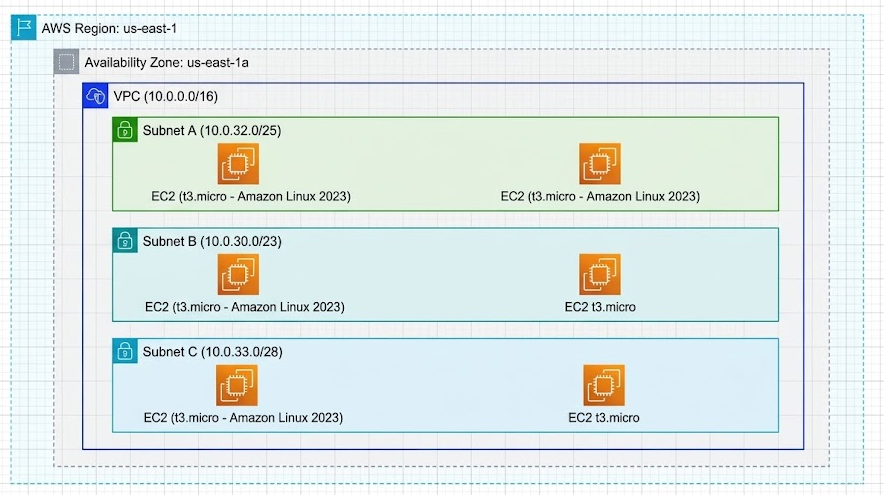
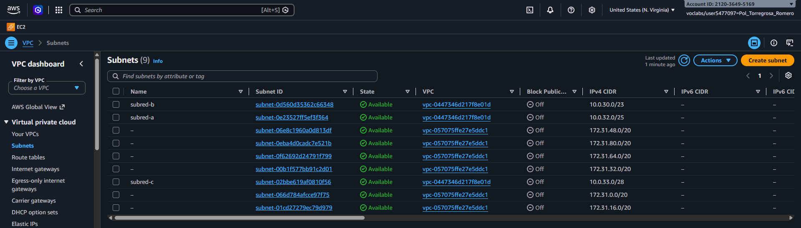
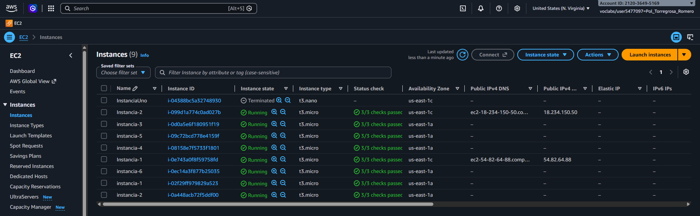

# Ejercicio 2: Disseny i Desplegament de VPC, Subxarxes i EC2

Despliegue de una VPC con 3 subredes y 6 instancias EC2 (`t3.micro`, Amazon Linux 2023) en la región `us-east-1`, zona `us-east-1a`.

## Direccionamiento IP y topología

| Recurso | CIDR / Tipo | Zona |
|---------|-------------|------|
| VPC | `10.0.0.0/16` | us-east-1 |
| Subnet A | `10.0.32.0/25` | us-east-1a |
| Subnet B | `10.0.30.0/23` | us-east-1a |
| Subnet C | `10.0.33.0/28` | us-east-1a |

Topología general:



VPC y subredes:



Instancias EC2:



## Recursos desplegados

- 1 VPC `10.0.0.0/16`.
- 3 subredes en `us-east-1a` con los CIDR indicados.
- 6 instancias EC2 `t3.micro` (2 por subred): `instancia-1` a `instancia-6`.

## Procedimiento

1. **Inicializar Terraform.**

   ```bash
   terraform init
   ```

2. **Revisar el plan.**

   ```bash
   terraform plan
   ```

3. **Crear la infraestructura.**

   ```bash
   terraform apply
   ```

4. **Destruir los recursos.**

   ```bash
   terraform destroy
   ```
